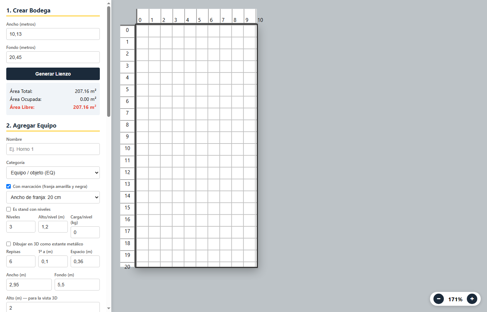

# Simulador de Planta — CTC Energy

Aplicación web (un solo HTML + CSS + JS, **sin dependencias**) para dibujar a escala la
distribución en planta de un taller o bodega, ubicar equipos, puertas y ventanas, calcular
áreas y ver el resultado en **3D** y en **PDF** para imprimir.



## ✨ Qué hace

- **Lienzo a escala real** (1 m = 20 px) con reglas en metros y zoom.
- **Bloques** con nombre, medidas, alto, peso, color y foto:
  - Equipos (`EQ`), Edificaciones (`E`) y Espacios libres / pasillos (`MA`).
  - **Marcación de seguridad** amarilla y negra alrededor del equipo (15 o 20 cm).
  - **Stands con niveles**: valida alto, área y carga por nivel, y muestra el % ocupado.
  - **Estantes metálicos** dibujados en 3D con postes y repisas.
- **Anti-solape**: al mover o crear, el bloque busca el hueco libre más cercano.
- **Puertas y ventanas**: se agregan a una pared (de la bodega o de una edificación),
  se arrastran contra la pared y se ajustan con una barra.
- **Vista 3D** con paredes, piso cuadriculado, fotos y sombras (se gira con el ratón).
- **Imprimir / PDF**: calcula la escala para que quepa en carta, con **leyenda de áreas**
  (totales, subtotales por categoría, stands y aberturas).
- **Guardado automático** en el navegador + **exportar / importar JSON**.
- **Deshacer** (hasta 40 pasos) y atajos de teclado.
- Funciona **sin conexión** y en **móvil** (arrastre táctil y panel deslizable).

## 📘 Manual de uso

Guía paso a paso en PDF: [docs/manual-usuario.pdf](docs/manual-usuario.pdf) (9 páginas, con capturas).

## 🚀 Cómo usarlo

1. Abre `index.html` en el navegador (doble clic) o visita la versión publicada.
2. Escribe el **ancho** y el **fondo** reales de la planta y pulsa **Generar Lienzo**.
3. Agrega equipos desde el panel: nombre, medidas, alto y color.
4. Arrastra los bloques para ubicarlos; usa **↻** para girarlos y **×** para borrarlos.
5. Pulsa **Ver en 3D** para revisar y **Imprimir / PDF** para la lámina con la leyenda.

### Atajos

| Tecla | Acción |
|---|---|
| `Ctrl` + `Z` | Deshacer |
| `Esc` | Cerrar la vista 3D |
| Rueda del ratón (en 3D) | Acercar / alejar |

## 🧪 Pruebas

La app trae un auto-test integrado. Abre:

```
index.html?selftest=1
```

Se ejecutan 16 comprobaciones (áreas, colocación sin solape, deshacer, stands,
aberturas, leyenda, escala de impresión, 3D y exportación). El resultado aparece en el
panel inferior y en el título de la pestaña: `OK 16/16`.

## 📁 Estructura

```
index.html               aplicación (todas las vistas)
assets/styles.css        estilos (responsive + estilos de impresión)
assets/app.js            lógica: modelo, render, colisiones, 3D, persistencia
manifest.webmanifest     metadatos de instalación (PWA básica)
docs/escenario-demo.json ejemplo de plano (10.90 × 19.45 m) para importar con "⬆ JSON"
docs/informe-demo.pdf    informe de ejemplo generado a partir de ese escenario
docs/                    capturas para el README
```

## 🧾 Probar con el escenario de ejemplo

1. Abre la app y pulsa **⬆ JSON** (abajo, en el panel).
2. Selecciona `docs/escenario-demo.json`.
3. Se carga una planta de 10.90 × 19.45 m con 6 edificaciones (oficina, recepción,
   baños, vestier, cuarto eléctrico y almacén), 21 equipos con marcación amarilla y
   negra, estanterías, 6 stands con niveles y 5 zonas de tránsito.
4. Pulsa **🖨️ Imprimir / PDF** para obtener la lámina con el cuadro de áreas.

El resultado de ese ejercicio está en `docs/informe-demo.pdf`.

## 🌐 Publicar en GitHub Pages

**Opción A — desde la rama (más fácil):**

1. Crea el repositorio y sube los archivos a la rama `main`.
2. En GitHub: **Settings → Pages → Build and deployment → Deploy from a branch**.
3. Elige rama `main`, carpeta `/ (root)` y guarda.
4. En 1–2 minutos queda en `https://<tu-usuario>.github.io/<repositorio>/`.

**Opción B — por línea de comandos:**

```bash
git init
git add .
git commit -m "Simulador de planta CTC Energy"
git branch -M main
git remote add origin https://github.com/<tu-usuario>/<repositorio>.git
git push -u origin main
```

> El archivo debe llamarse `index.html` (ya está así) para que Pages lo abra por defecto.

## 🔒 Privacidad

Todo el cálculo ocurre en el navegador. **Las fotos y los datos del plano nunca se suben a
ningún servidor**: se guardan en el `localStorage` del equipo (sin las fotos, para no
agotar la cuota) y en el JSON que tú exportes.

## 🧭 Roadmap

- [ ] Exportar el plano a PNG/PDF directamente (sin pasar por imprimir).
- [ ] Dibujar paredes interiores como elementos propios.
- [ ] Modo colaborativo / enlace para compartir.
- [ ] Instalación PWA con service worker (offline completo).

## 📄 Licencia

MIT — ver [LICENSE](LICENSE).
