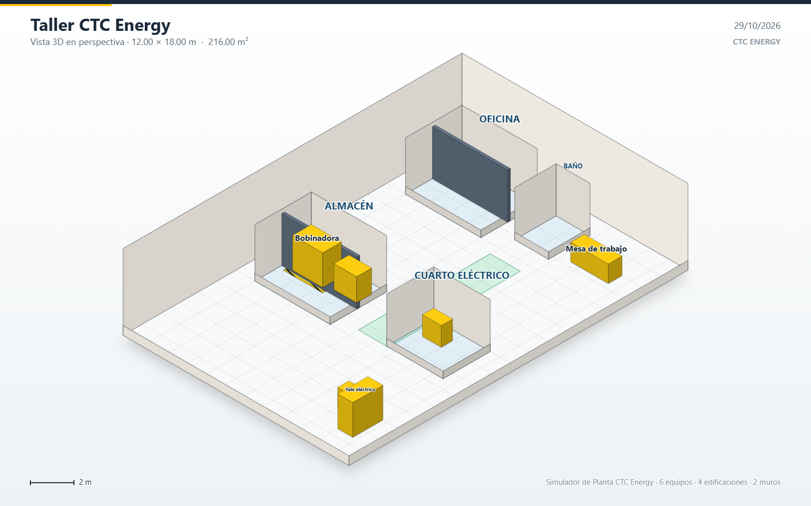
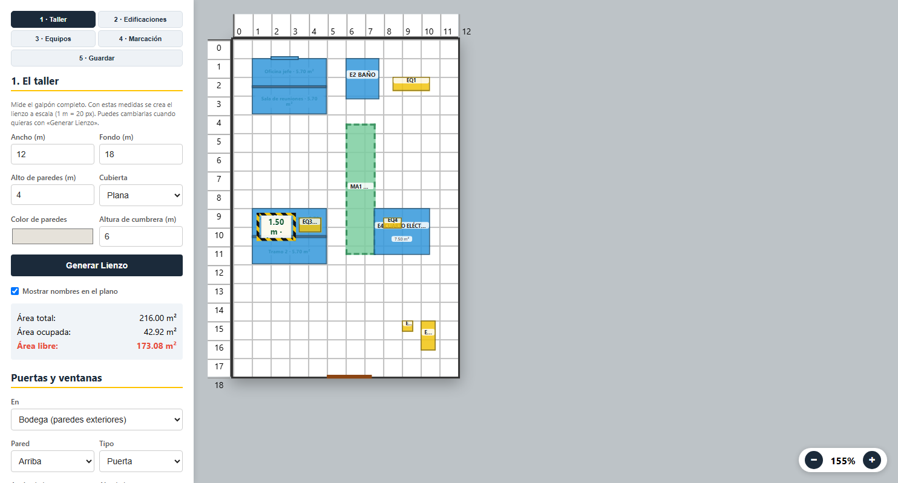
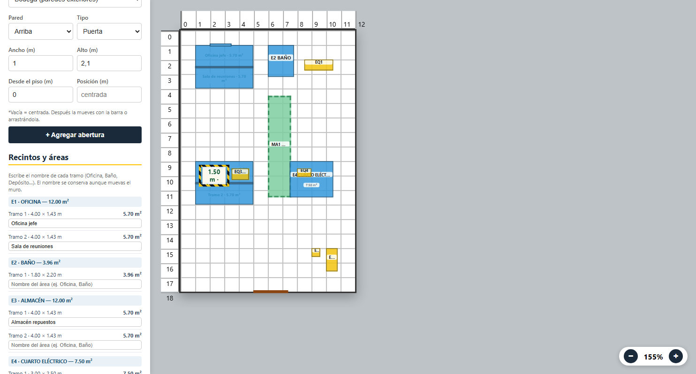
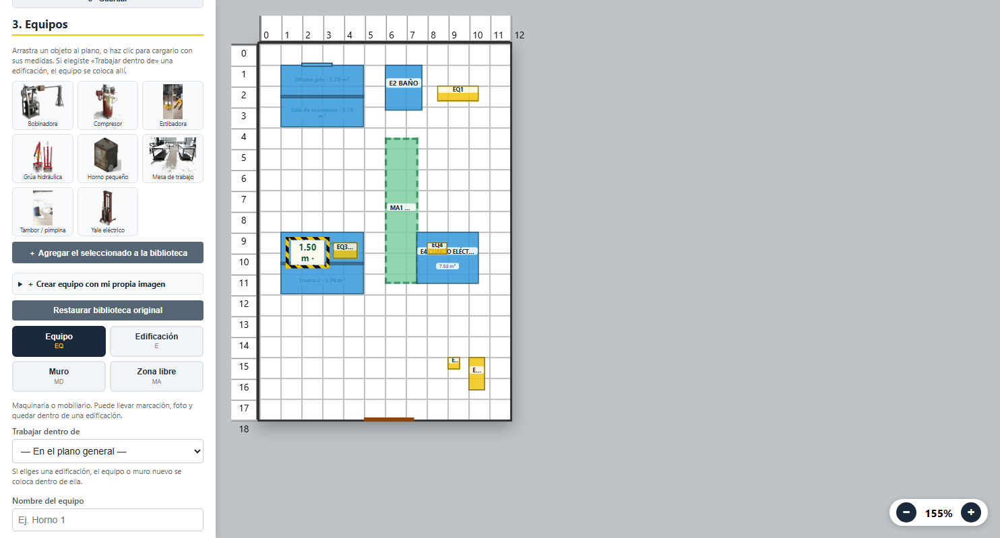
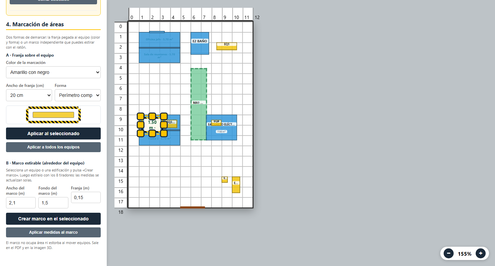
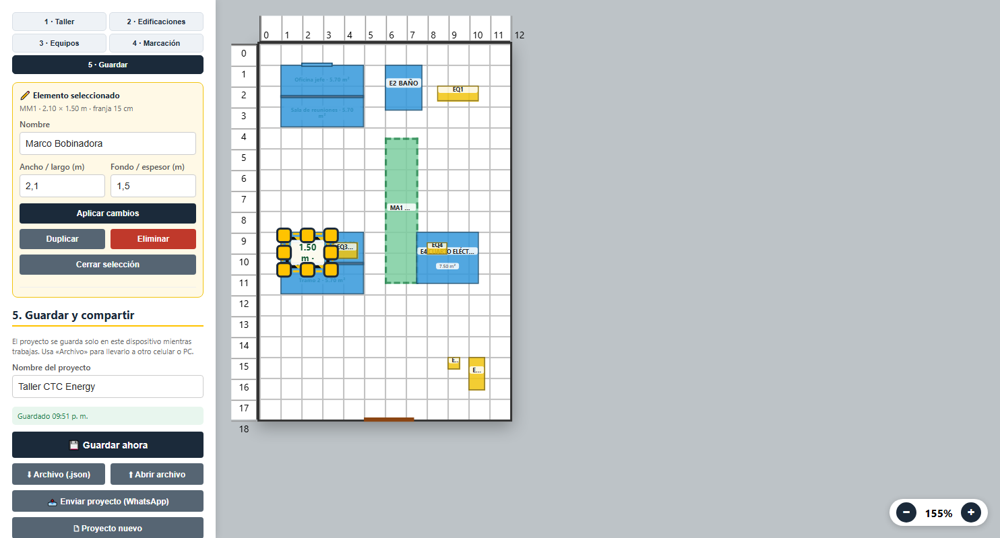

# Simulador de Planta — CTC Energy

Aplicación web para dibujar **a escala** la planta de un taller o bodega, dividirla en
edificaciones y recintos, ubicar equipos, demarcar zonas y ver el resultado en **3D**.
Funciona sin conexión, se instala en el celular o en el PC y **guarda el trabajo solo**.



> Versión **1.4** · Un solo HTML + CSS + JS, **sin dependencias** · Publicada en
> [GitHub Pages](https://jeydiaza-ui.github.io/simulador-planta/).

## ⬇️ Descargar

- **Usar la app ahora**: <https://jeydiaza-ui.github.io/simulador-planta/>
- **Descargar el código**: <https://github.com/jeydiaza-ui/simulador-planta>
  → botón **Code → Download ZIP**. Descomprime y abre `index.html` (o publica tu copia).

---

## 🚀 Lo nuevo en la versión 1.4

- **Trabajo por etapas**: 1 Taller · 2 Edificaciones · 3 Equipos · 4 Marcación · 5 Guardar.
- **Guardado automático real** en el dispositivo (IndexedDB, con las fotos incluidas).
  Botones para **guardar un archivo** y **abrirlo en otro celular o PC**.
- **Compartir en 3D por WhatsApp**: genera un **PNG isométrico** de 1600 × 1000 px y abre
  la hoja de compartir del teléfono (o lo descarga para adjuntarlo).
- **Edificaciones independientes**: crea el cuarto, elige *Trabajar dentro de* y agrega
  muros, puertas, ventanas y equipos. Al mover la edificación, **se mueve todo su contenido**.
- **Recintos con nombre y área**: los muros divisorios parten el cuarto y cada tramo
  muestra su nombre y sus m² (también en el PDF).
- **Biblioteca con tus propias imágenes**: crea equipos con nombre, medidas y foto desde el
  celular o el PC; quedan guardados en el dispositivo.
- **Marco de marcación estirable**: un marco alrededor del equipo con **8 tiradores**;
  al estirarlo, las medidas se actualizan en vivo.
- **PDF 2D** con plano a escala + tablas de convenciones, áreas por categoría, recintos,
  puertas/ventanas y marcos.
- **Instalable y sin conexión** (PWA con service worker).

## ✨ Qué hace

- **Lienzo a escala real** (1 m = 20 px) con reglas en metros y zoom.
- **Bloques** con nombre, medidas, alto, color y foto:
  - Equipos (`EQ`), edificaciones (`E`), muros (`MD`), zonas libres (`MA`) y marcos (`MM`).
  - **Marcación de seguridad** amarilla/negra, roja/blanca, lisa o de color, en 5 formas.
  - **Stands con niveles** y **estantes metálicos** dibujados en 3D.
- **Anti-solape** al mover o crear (se puede desactivar con *Mover libre*).
- **Puertas y ventanas** en paredes del taller o de cualquier edificación, con hueco real en 3D.
- **Vista 3D** con paredes, piso cuadriculado, fotos, sombras y giro con el ratón.
- **Deshacer** (hasta 40 pasos), atajos de teclado y guardado al salir.

## 🧭 Cómo trabajar por etapas (5 minutos)

| Etapa | Qué haces |
|---|---|
| **1 · Taller** | Escribes ancho, fondo, alto de paredes y tipo de techo → **Generar Lienzo**. Agregas puertas y ventanas del galpón. |
| **2 · Edificaciones** | Creas oficinas, baños, almacén… Eliges **Trabajar dentro de** y agregas sus **muros** (el ancho del cuarto), puertas, ventanas y equipos. Nombra los **recintos**. |
| **3 · Equipos** | Arrastras de la biblioteca al plano o creas tu equipo con foto y medidas (ancho × fondo × alto). |
| **4 · Marcación** | Eliges color, ancho y forma de la franja; o creas un **marco estirable** y lo ajustas con los tiradores. |
| **5 · Guardar** | Pones el nombre del proyecto, guardas, envías el **3D por WhatsApp** o imprimes el **PDF**. |

### Capturas











## 💾 Guardar, abrir y compartir

- **Se guarda solo** mientras trabajas (en este navegador/dispositivo). El indicador de la
  pestaña **5 · Guardar** dice la hora del último guardado.
- **💾 Guardar ahora**: fuerza el guardado inmediato.
- **⬇ Archivo (.json)**: descarga el proyecto completo **con las fotos**. Sirve para
  respaldarlo o pasarlo a otro celular/PC.
- **⬆ Abrir archivo**: carga un proyecto .json (reemplaza el actual).
- **📤 Enviar proyecto (WhatsApp)**: comparte el archivo del proyecto por la hoja de
  compartir del teléfono (o lo descarga para adjuntarlo).
- **📤 Compartir 3D**: genera la imagen isométrica y la comparte por WhatsApp u otra app.
- **🖨️ Imprimir / PDF 2D**: abre la impresión con el plano a escala y las tablas; en el
  celular elige **Guardar como PDF**.

> En el PC también puedes usar `Ctrl + S` para guardar y `Ctrl + Z` para deshacer.

## 📱 Instalar en el celular

1. Abre la versión publicada en Chrome (Android) o Safari (iPhone).
2. Menú del navegador → **Instalar app** / **Agregar a pantalla de inicio**.
3. Queda como una app; funciona sin conexión después de la primera carga.

## 🧪 Pruebas

La app trae dos auto-tests:

```
index.html?selftest=1     →  44 comprobaciones (áreas, recintos, marcos, 3D, PDF, biblioteca)
index.html?test=1         →  3 comprobaciones de guardado (IndexedDB) y PNG
```

El resultado aparece en el panel inferior y en el título de la pestaña: `OK 44/44`.

## 📁 Estructura

```
index.html               aplicación (las 5 etapas y todas las vistas)
assets/styles.css        estilos (responsive, móvil e impresión)
assets/app.js            modelo, render, colisiones, recintos, 3D, guardado
assets/compartir.js      PNG isométrico para compartir
assets/biblioteca.js     biblioteca base de equipos (imágenes incluidas)
assets/icons/            íconos de la app instalable
sw.js                    service worker (offline)
manifest.webmanifest     metadatos PWA
docs/                    capturas, guía y escenarios de ejemplo
docs/manual-usuario.pdf  guía rápida ilustrada (PDF, 6 páginas)
docs/escenario-demo.json ejemplo de plano para importar con "⬆ Abrir archivo"
```

## 🧾 Probar con el escenario de ejemplo

1. Abre la app y pulsa **⬆ Abrir archivo** (etapa 5).
2. Selecciona `docs/escenario-demo.json`.
3. Se carga una planta de 10.90 × 19.45 m con 6 edificaciones, 21 equipos con marcación,
   estanterías y 5 zonas de tránsito.
4. Pulsa **🖨️ Imprimir / PDF** para obtener la lámina con el cuadro de áreas.

## 🌐 Publicar en GitHub Pages

El repositorio ya está publicado. Para actualizarlo:

```bash
cd 08_simulador_web
git add .
git commit -m "Simulador de planta CTC Energy v1.4"
git push
```

GitHub → **Settings → Pages**: rama `main`, carpeta `/ (root)`. El archivo `index.html`
debe quedar en la raíz (ya está así).

## 🔒 Privacidad

Todo el cálculo ocurre en el navegador. **Las fotos y los datos del plano nunca se suben a
ningún servidor**: se guardan en el almacenamiento del equipo y en el archivo que tú exportes.

## 🧭 Roadmap

- [ ] Exportar el PDF directamente desde la app (sin pasar por imprimir).
- [ ] Dibujar paredes con clic y arrastre (hoy se agregan como bloques).
- [ ] Modo colaborativo / enlace para compartir.
- [ ] Undo/redo con nombres de acción.

## 📄 Licencia

MIT — ver [LICENSE](LICENSE).
